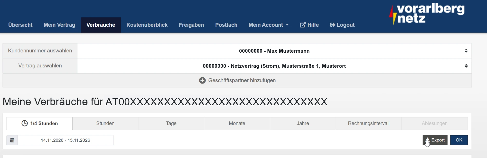

# Netzkosten_AT_2027

Vergleich der Netzkosten mit Leistungstarif ab 2027 – für alle 14 Netzbereiche in Österreich.

Ein oder mehrere 15-Minuten-Lastprofile (CSV, z. B. Smart-Meter-Export des Netzbetreibers) hochladen, und das Tool berechnet sofort die jährlichen Netzkosten **2026 (Ist)** und **2027 (Leistungstarif)** für jeden Netzbereich. Die Datei wird ausschließlich lokal im Browser verarbeitet – es werden keine Daten hochgeladen.

## Verwendung

**Online:** https://helyxx.github.io/Netzkosten_AT_2027/

Oder lokal: `index.html` im Browser öffnen und die CSV-Datei(en) per Drag & Drop ablegen.

## Funktionen

- Vergleich 2026 ↔ 2027 für alle Netzbereiche, inkl. Differenz in € und %
- Detail-Aufschlüsselung für den eigenen Netzbereich (Pauschale/Leistungspreis, Arbeitspreis, Netzverlust, Messentgelt)
- Monatliche Leistungsspitzen mit Staffelgrenze (10 kW) und Mindestleistung (2 kW)
- Was-wäre-wenn: Spitzenkappung (Lastmanagement, Batterie, Wallbox drosseln)
- Top-10-Viertelstunden, CSV-Export, brutto/netto-Umschaltung
- Hochrechnung bei unvollständigen Daten
- Alle Tarife im Tool editierbar (werden im Browser gespeichert)

## Beispiel: Export aus dem Kundenportal

> **Getestet mit dem Export der Vorarlberg-Netz.**

Im Kundenportal unter **Verbräuche** die Ansicht **1/4 Stunden** wählen, den Zeitraum einstellen und auf **Export** klicken. Die heruntergeladene CSV-Datei direkt im Tool ablegen. Lässt sich nicht der ganze Zeitraum auf einmal exportieren, einfach mehrere Teil-Exporte erstellen und gemeinsam hochladen.

## Unterstützte CSV-Formate

- Mehrere Dateien auf einmal (z. B. in Teilzeiträume aufgeteilter Export): werden zusammengeführt, Überlappungen nur einmal gezählt
- Trennzeichen `;`, `,` oder Tab; Dezimalkomma oder -punkt
- Datum `TT.MM.JJJJ hh:mm`, `JJJJ-MM-TT hh:mm` (auch ISO mit `T`) oder getrennte Datums-/Zeitspalten
- Werte in kW oder kWh je Viertelstunde – erkannt über Spaltenname oder eine Spalte `Einheit`
- Zeitstempel als Intervallbeginn oder -ende (automatische Erkennung)
- Metadatenzeilen vor der Kopfzeile werden übersprungen; negative Werte gelten als Einspeisung
- Qualitätsspalte (`L1` = Echtwert) wird ausgewertet und Ersatzwerte werden gemeldet

## Berechnung

**2026:** Arbeitspreis × kWh + Netzverlust × kWh + Pauschale 54 €/Jahr + Messentgelt

**2027 Leistungstarif:** je Kalendermonat die höchste Viertelstunde (mindestens 2 kW); bis 10 kW zum Grundsatz, der Anteil darüber zum höheren Satz. Dazu Arbeitspreis × kWh + Netzverlust × kWh. Pauschale und Messentgelt entfallen.

## Datenquellen und Einschränkungen

- **2026:** SNE-V 2018 i. d. F. 2026, laut [fixkostenreduzierer.at](https://www.fixkostenreduzierer.at/ratgeber/netzentgelt-erklaert)
- **2027:** Begutachtungsentwurf SNE-T-V 2027 der E-Control vom 29.10.2026, laut [stromliste.at](https://stromliste.at/strompreis/zusammensetzung/netzentgelte/leistungstarif) – **noch nicht verbindlich**
- Netzverlust 2027 ist im Entwurf nicht veröffentlicht – es wird der Wert von 2026 angenommen
- Nicht berücksichtigt: SNAP/WiNAP-Rabatte, flexible Leistung (−75 %), Energiegemeinschaften, Abgaben und Energiepreis
- Umstellung für Haushalte frühestens 1.12.2027, spätestens 1.7.2028 – bis dahin gilt eine Übergangspauschale
- Hintergrund: [help.ORF.at – Stromnetztarife](https://help.orf.at/stories/3237714/)

Alle Angaben ohne Gewähr.
